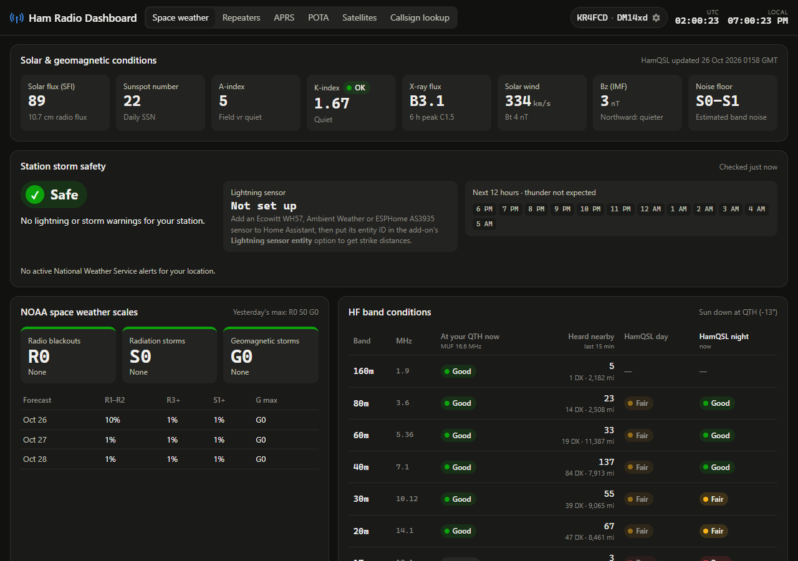
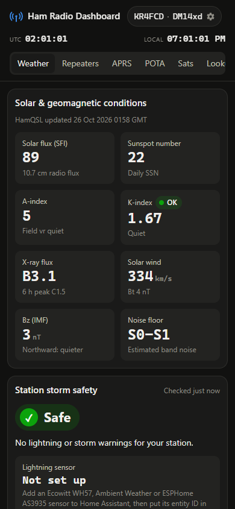
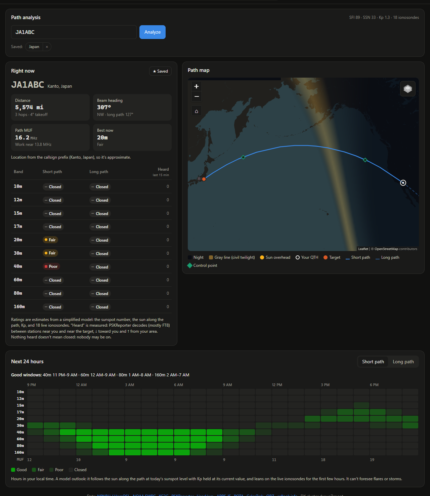
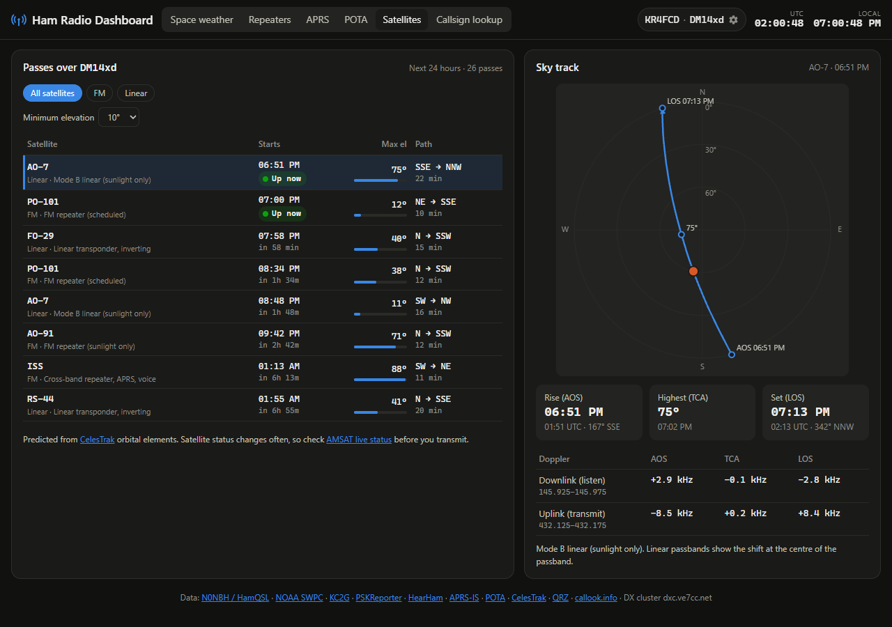

# Swamp Fox Labs Apps

Home Assistant apps (add-ons) by Swamp Fox Labs, KR4FCD.

## Add this repository

1. In Home Assistant go to **Settings → Apps**, then open the app store.
2. Open the **⋮** menu → **Repositories**, and add:

   ```
   https://github.com/SWFX2324/swamp-fox-labs-apps
   ```

3. The apps below appear under **Swamp Fox Labs Apps**.

Requires Home Assistant OS or a Supervised install (amd64 or aarch64).

Images are prebuilt for both architectures, so installs and updates download a
ready image instead of building one on your machine.

## Apps

| | App | Description |
| --- | --- | --- |
|  | [Ham Radio Dashboard](ham_dashboard) | Point-to-point HF propagation to anywhere (now and the next 24 hours, checked against PSKReporter), HF band conditions (160–10 m), NOAA R/S/G scales, SFI, sunspots, K/A index, gray line and MUF maps, DX cluster spots, PSKReporter and NOAA alerts, plus nearby repeaters, live APRS, POTA spots, satellite passes, QRZ/FCC callsign lookup, measured band activity, 6 m and 2 m openings, storm safety, and Home Assistant sensors and alerts. |

<p>
  
  
</p>
<p>
  
  
</p>

## Developing

Each app lives in its own folder with a `config.yaml`. The Ham Radio Dashboard backend
is one Node.js file with no dependencies. To run it outside Home Assistant:

```bash
CALLSIGN=N0CALL GRID=DM14xd PORT=8099 node ham_dashboard/app/server.js
```

Then open http://localhost:8099. Run the unit tests with:

```bash
node --test "ham_dashboard/tests/*.test.js"
```

### Releases

Every push to `main` that touches `ham_dashboard/` runs two GitHub Actions:

- **Checks** (on every push and pull request): Home Assistant's app linter, a syntax
  check of every script and the unit tests.
- **Build images**: builds `ghcr.io/swfx2324/ham-dashboard-amd64` and
  `ham-dashboard-aarch64`, tagged with the version in `config.yaml` and `latest`.
  Pull requests and other branches only build, so a released version's image is
  never replaced by unreleased code.

Home Assistant offers an update as soon as `config.yaml` on `main` has a new
version, and the images take a few minutes to build. An update started in that
window fails with "image not found"; it works once the build finishes.

## License

[MIT](LICENSE) © 2026 KR4FCD. The license covers the code in this repository. Data
shown by the apps is still subject to each source's own terms.
